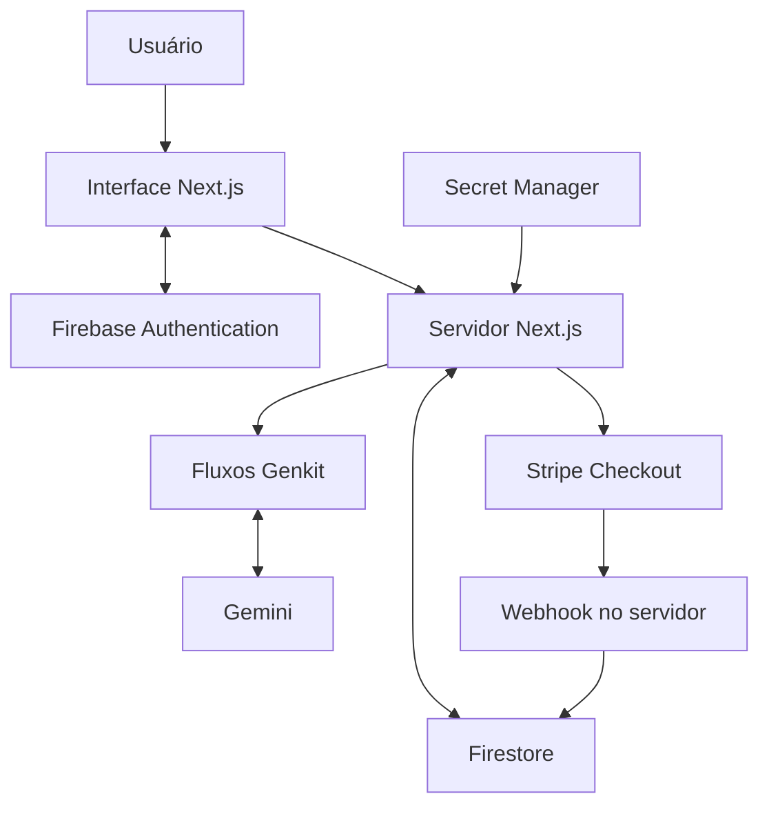

# Xtreme Dr. X — assistente de instalação com IA

Aplicação web para apoiar a instalação e o diagnóstico do **Quickshifter Xtreme**, com perguntas em linguagem natural e análise de fotos e vídeos.

**[Abrir a aplicação publicada](https://studio--studio-6575887507-cfd43.us-central1.hosted.app/)** · [Conhecer meus outros projetos](https://github.com/sandrocabelleira1)

> Este repositório apresenta o estudo de caso e a arquitetura do projeto. Algumas funções da aplicação exigem autenticação. O checkout Stripe opera em modo de produção.

## Problema e proposta

Dúvidas sobre instalação e funcionamento de um quickshifter podem depender tanto da descrição do problema quanto de detalhes visuais. O Xtreme Dr. X reúne conversa e mídia em uma interface para apoiar a análise dessas dúvidas.

O projeto explora uma aplicação de IA conectada a uma experiência de produto: conta de usuário, histórico e dados persistentes, consumo de créditos e integração de pagamentos.

## O que o projeto demonstra

| Área | Implementação |
| --- | --- |
| IA generativa | Fluxos Genkit com Gemini 2.5 Flash e respostas estruturadas |
| Multimodalidade | Entrada de texto, imagens e vídeos com contexto de conversa |
| Aplicação web | Next.js 15, React e TypeScript |
| Identidade e dados | Firebase Authentication, Firestore e Firebase Admin |
| Pagamentos | Stripe Checkout e webhook com validação de assinatura |
| Interface | Tailwind CSS e componentes Radix UI |
| Publicação | Firebase App Hosting conectado ao GitHub e credenciais no Secret Manager |

## Fluxo da aplicação

1. O usuário acessa a aplicação e se autentica para utilizar as funções protegidas.
2. Envia uma pergunta e, opcionalmente, uma foto ou um vídeo.
3. O servidor organiza a solicitação e o contexto para um fluxo Genkit.
4. O Gemini processa a entrada e a resposta retorna à interface de chat.
5. A integração com Firebase mantém os dados do produto; Stripe Checkout e webhook compõem o fluxo de compra de créditos.

## Arquitetura resumida

## Desafios de engenharia

- **Conectar IA e produto:** integrar entradas multimodais ao fluxo de conversa, além de lidar com autenticação, dados e créditos.
- **Tratar identidade no servidor:** verificar a identidade do usuário nas operações protegidas.
- **Gerenciar credenciais:** manter valores secretos fora do código e configurar acesso para a conta de serviço da aplicação.
- **Resolver a implantação:** diagnosticar uma incompatibilidade entre o identificador do vínculo GitHub no Developer Connect e a validação do Cloud Build.
- **Operar a aplicação:** acompanhar preparação, compilação, publicação e distribuição de tráfego no Firebase App Hosting.

## Publicação verificada

Em **17/10/2026**, a versão da branch `security/checkout-and-credits` foi publicada:

- Compilação de produção concluída e 10 páginas geradas.
- Build `build-2026-10-17-009` no estado `READY`.
- Rollout concluído com sucesso e 100% do tráfego direcionado à versão.
- Página inicial respondendo HTTP 200 após a publicação.

Essa verificação cobre compilação, implantação e disponibilidade da página inicial. A validação completa dos fluxos autenticados e de pagamento segue como parte da evolução do projeto.

## Evolução

- Ampliar a cobertura de testes dos fluxos autenticados, de créditos e de pagamento.
- Avaliar a qualidade das respostas de IA com cenários de uso definidos.
- Preparar capturas de tela e um vídeo curto de demonstração.
- Melhorar a experiência de apresentação para quem visita o projeto pela primeira vez.

O código-fonte permanece privado. Este repositório público reúne a apresentação técnica, as decisões de implementação e a evolução do produto.
